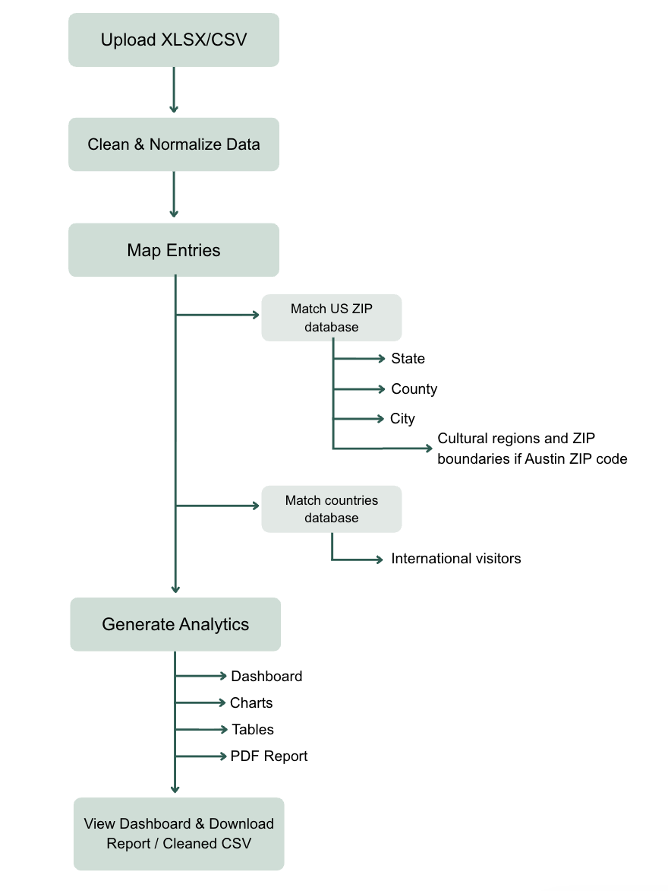
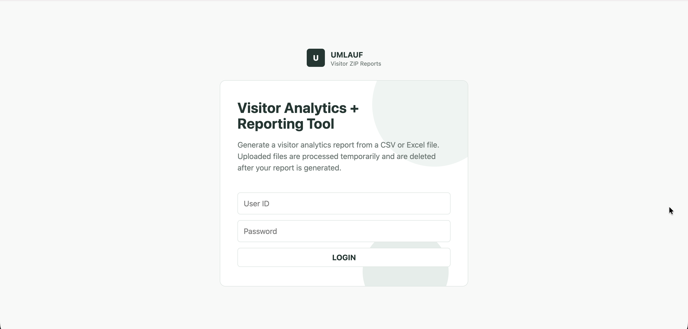
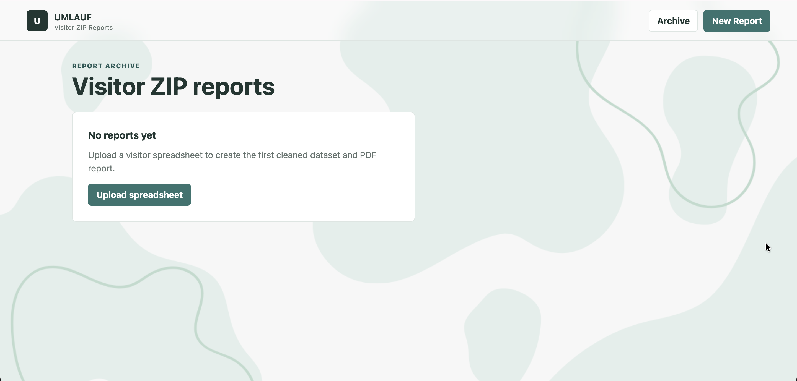
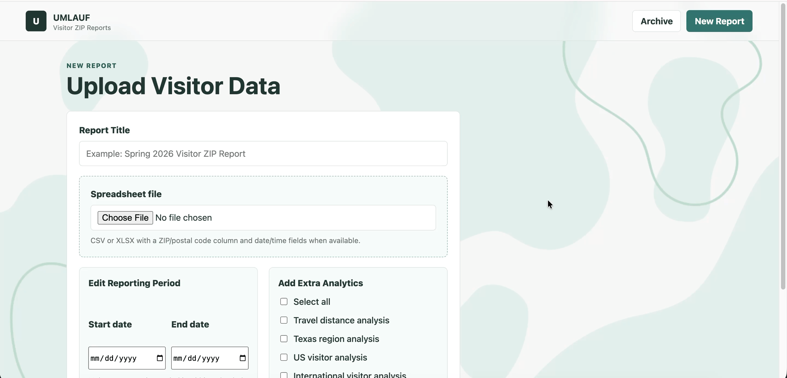
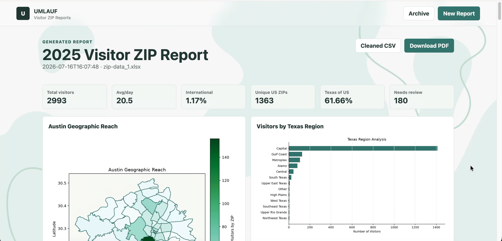
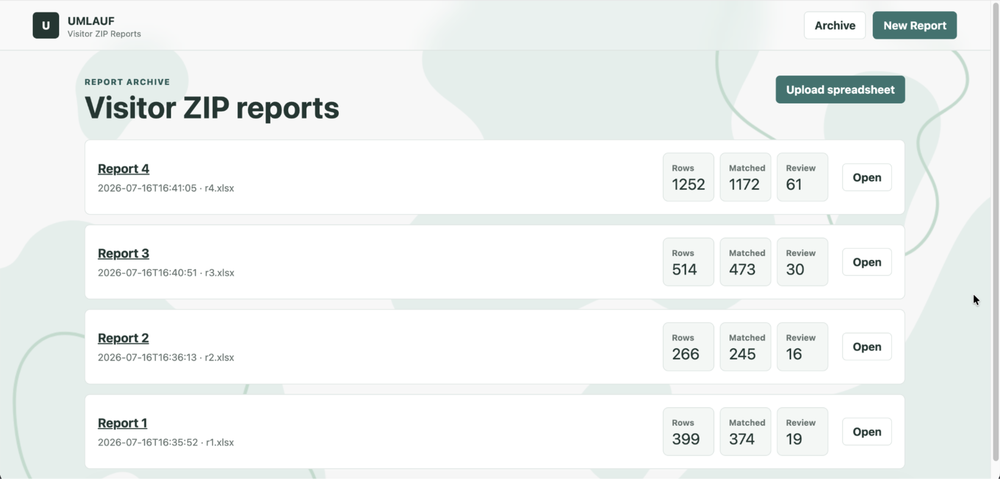

# **UMLAUF Visitor Analytics \+ Reporting Tool**

*A custom visitor analytics and reporting platform for the UMLAUF Sculpture Garden \+ Museum.*
***NOTE: The source code for this project is proprietary to protect UMLAUF's business operations and data***

| Type | Full-stack web application |
| :---- | :---- |
| **Role** | Solo Developer & System Architect |
| **Client** | UMLAUF Sculpture Garden \+ Museum |
| **Purpose** | Automate visitor analytics and reporting |
| **Primary technologies** | Django, Pandas, Matplotlib, ReportLab |

## **Overview**

The UMLAUF Visitor Analytics \+ Reporting Tool is a Django-based web application that automates the process of transforming raw visitor location data into meaningful geographic analytics and professional reports. 

Custom built for and currently used by the UMLAUF Sculpture Garden \+ Museum in Austin, Texas, the application replaces a manual reporting workflow with an automated pipeline that cleans visitor data, generates visualizations, and produces polished PDF reports to reference for grant reporting, marketing, and community outreach analysis.

### **Problem**

This automation system was developed to solve a real operational challenge faced by the UMLAUF Sculpture Garden \+ Museum. 

Previously, employees manually had to clean visitor spreadsheets, look up geographic information, create charts, and build reports. This was error-prone and consumed valuable staff time due to the sheer number of entries. 

### **Solution**

The Visitor Analytics \+ Reporting Tool streamlines this entire workflow. Staff simply upload a CSV or Excel spreadsheet, and the application automatically:

* Cleans and normalizes visitor location data  
* Enriches U.S. ZIP codes with geographic information  
* Identifies international visitors  
* Generates analytics, maps, and charts  
* Produces a downloadable PDF report  
* Creates a cleaned and enriched CSV dataset for future use

Staff can customize each report by selecting the reporting period and choosing additional analytics beyond the standard base report, allowing reports to be adjusted for different audiences or marketing initiatives.

The application is designed for a small internal team (1–2 employees) and prioritizes simplicity, reliability, and ease of use over unnecessary complexity, allowing the museum staff to focus on interpreting visitor trends and applying them to boost business rather than preparing data.

## **Report Automation Architecture**

##  **Engineering Decisions**

* Designed a robust data-cleaning pipeline capable of handling inconsistent visitor entries  
* Used thorough United States ZIP code and country lookup tables to ensure accurate and reproducible analytics to reference for grant reporting  
* Preserved invalid and unrecognized data entries instead of discarding them, allowing staff to review data quality  
* Designed the reporting engine to support customization for different purposes through editing reporting periods and selecting optional analytics to be included in the report   
* Maintained a simple authentication model with a single administrator account since the application is designed for internal company use by a small team  
* Built a clean UI for non-technical museum staff to use with minimal training

### **Future Work**

* Connect directly to the museum’s data collection forms to automate quarterly, annual, and fiscal-year reporting  
* Introduce persistent storage for historical reports and dashboards  
* Schedule recurring report delivery   
* Trend analysis across multiple reporting periods

### **Technology**

| Technology | Purpose |
| :---- | :---- |
| Django | Backend web framework |
| HTML/CSS | User interface |
| Pandas | Data cleaning and transformation |
| Numpy | Mathematical and numerical processing |
| Matplotlib | Chart and map creation |
| OpenPyXL | XLSX file upload handling & visual polish on PDFs |
| ReportLab | PDF download feature |

### 

### **Screenshots**

Login Page:

Empty Report Archive:

Upload Page:

Dashboard Page:

Report Archive:

